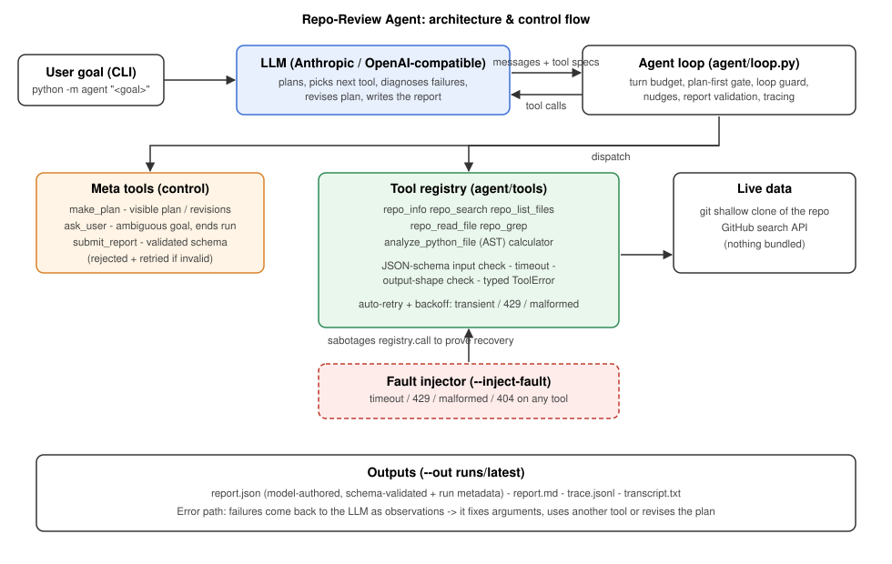

# Repo-Review Agent: an LLM-driven autonomous code reviewer

Give it a goal such as *"Review the code quality of https://github.com/psf/requests and suggest fixes"*.
A language model **plans, chooses tools one step at a time, reads real results, recovers from failures and
writes the final structured report**. Repositories are fetched live at run time; no dataset is bundled.



## What is (and is not) hard-coded

| Decided by the LLM | Provided by code |
|---|---|
| the plan and any revisions (`make_plan`) | tool implementations (git clone, grep, AST analyzer, calculator) |
| which tool to call next and with what arguments | JSON-schema input checks, timeouts, output-shape checks |
| how to react to a failure (fix a typo'd repo name, change path, switch tool, narrow scope) | automatic retry + backoff for *transient* faults (timeout / 429 / malformed) |
| when to ask for clarification (`ask_user`) | turn budget, plan-first gate, repeated-failure warning |
| which findings matter, the score, the fixes, the whole report (`submit_report`) | report schema validation (invalid reports are sent back to the model) |

There is **no offline/template planner, no canned findings and no static fix text** in the product code.
The static analyzer is just one tool the model may call; the model must verify its hints by reading code.

## Requirements and setup

* Python 3.10+, `git` on PATH, outbound HTTPS to github.com and to your model provider.
* An API key for **either** provider (any one is enough):

```bash
git clone <this repo> && cd <this repo>
python3 -m venv .venv && source .venv/bin/activate        # Windows: .venv\Scripts\activate
pip install -r requirements.txt                            # just `requests` (+ pytest)

export ANTHROPIC_API_KEY=sk-ant-...                        # Windows PowerShell: $env:ANTHROPIC_API_KEY="..."
#   or
export OPENAI_API_KEY=sk-...                               # also works with any OpenAI-compatible endpoint:
#   export OPENAI_BASE_URL=https://generativelanguage.googleapis.com/v1beta/openai   (Gemini)
#   export OPENAI_BASE_URL=https://api.groq.com/openai/v1  |  http://localhost:11434/v1 (Ollama, key = anything)
#   export AGENT_MODEL=<model id>                          # optional; or use --model
```

## Run

```bash
python -m agent "Review the code quality of https://github.com/pallets/flask and suggest fixes"
python -m agent --provider openai --model gpt-4.1 "Review github.com/psf/requests"

# Induce failures on purpose and watch the agent cope (TOOL:MODE[:N], repeatable)
python -m agent "Review https://github.com/pallets/flask" \
  --inject-fault repo_list_files:timeout:2 --inject-fault repo_read_file:malformed:1 --inject-fault repo_read_file:not_found:1

# Ambiguous goal -> it should ask for clarification instead of guessing
python -m agent "make my code better"
```

The live trace shows `PLAN`, `THINK` (the model's own commentary), `CALL`, `OK`/`FAIL`, `FIX` (automatic retries,
loop-guard) and `DONE` lines. Outputs go to `--out` (default `runs/latest/`): `report.md`, `report.json`,
`trace.jsonl`, `transcript.txt`. Exit code: 0 success/partial, 1 failed/needs_clarification, 2 setup error.
Other flags: `--max-turns`, `--backoff`, `--timeout`, `--no-cache`, `--quiet`.

### Web UI (Streamlit)

```bash
pip install streamlit
streamlit run app.py          # opens http://localhost:8501
```

Pick the provider/model and paste the key in the sidebar, type a goal and press **Run agent**: the agent's trace
(plan, tool calls, failures, recoveries) streams live, then the model-written report is shown with score,
findings (evidence + suggested fix), recoveries, assumptions and limitations. Faults can be injected from the
sidebar. The **Saved runs** tab browses every run in `examples/` and `runs/`. The UI calls the same `run_agent`
loop as the CLI; it adds no logic of its own.

## Tests (offline, ~1s)

```bash
python -m pytest -q
```

The tests run the real agent loop and real tools against a local git repository. The *model's decisions* are
supplied by a scripted test double (`tests/fake_llm.py`, never imported by the product) so that the loop,
retries, guard-rails, report validation and the two provider wire formats can be checked deterministically.
**They do not test model quality**: that is what the sample runs are for.

## Sample runs

`scripts/make_samples.sh` regenerates `examples/run1..run4` (normal, injected faults, misspelled repo, ambiguous
goal) with your key. Each directory holds the plan, every tool call, failures/recoveries and the final report.

## Layout

```
agent/loop.py      the agent: plan gate, tool dispatch, retries, guard-rails, termination
agent/llm.py       Anthropic + OpenAI-compatible adapters behind one interface (with API retry/backoff)
agent/report.py    report schema (given to the model), validation, markdown rendering
agent/tools/       repo_info/search/list/read/grep, analyze_python_file (AST), calculator, registry
agent/faults.py    deliberate failure injection      agent/trace.py   event tracing
app.py             Streamlit web UI (live trace + rendered report + saved-run browser)
tests/             19 offline tests (see above)  docs/architecture.svg
```

## Honest notes and limitations

* Quality depends on the model you use; weak models may plan poorly. The loop validates and nudges but does not
  replace judgement. Costs scale with turns (default cap: 30) and tool-result size (capped at ~7k chars/call).
* Repo contents come from a shallow `git clone` (no API quota). The analyzer is Python-only AST heuristics;
  the model may read any text file with `repo_read_file`/`repo_grep` but only Python gets automatic analysis.
* Threads cannot kill a hung tool call, only stop waiting for it.
* Fault injection is the only simulated component and is labelled `INJECTED` in logs.
