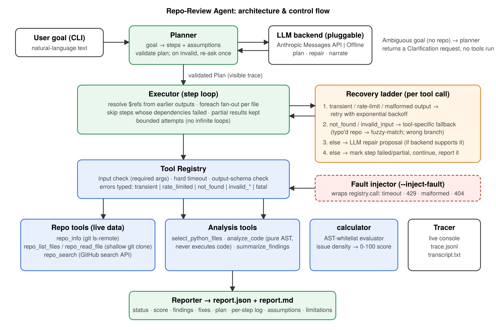

# Repo-Review Agent: an autonomous code-quality reviewer

Give it a goal such as *"Review the code quality of https://github.com/psf/requests and suggest fixes"*.
It plans, calls tools against **live** data, recovers from failures, and writes a structured report.
No dataset is bundled: repositories are fetched at run time.



## What it satisfies from the brief

| Requirement | Where |
|---|---|
| (a) high-level goal in | CLI: `python -m agent "<goal>"` |
| (b) autonomous decomposition + **visible planning trace** | `agent/planner.py`; printed as `PLAN` lines before any tool runs |
| (c) 2+ distinct tools | `repo_info`, `repo_list_files`, `repo_read_file`, `repo_search`, `select_python_files`, `analyze_code`, `summarize_findings`, `calculator` |
| (d) self-correction | `agent/executor.py` recovery ladder (retry/backoff → tool fallback → LLM repair → degrade) |
| (e) structured final report | `report.json` and `report.md` |
| deliberate induced failures | `--inject-fault` flag and real failures (misspelled repo), see below |

## Setup

```bash
python3 -m venv .venv && source .venv/bin/activate
pip install -r requirements.txt        # requests (+ pytest)
# needs `git` on PATH and outbound HTTPS to github.com
```

## Run

```bash
# Offline backend (default): deterministic planner, no API key needed. Tools still hit live GitHub.
python -m agent "Review the code quality of https://github.com/pallets/flask"

# Real LLM planner (plan / repair / summary written by the model)
export ANTHROPIC_API_KEY=sk-ant-...        # optional: AGENT_MODEL=<model id>
python -m agent --llm anthropic "Review github.com/psf/requests and suggest fixes"

# Demonstrate recovery with deliberately sabotaged tools (TOOL:MODE[:N], repeatable)
python -m agent "Review https://github.com/pallets/flask" \
    --inject-fault repo_list_files:timeout:2 --inject-fault repo_read_file:malformed:1 \
    --inject-fault repo_read_file:rate_limit:1 --inject-fault repo_read_file:not_found:1
```

Outputs go to `--out` (default `runs/latest/`): `report.md`, `report.json`, `trace.jsonl` (machine-readable
events), `transcript.txt`. Exit code is 0 for `success`/`partial`, 1 for `failed`/`needs_clarification`.
Other flags: `--backoff`, `--timeout`, `--no-cache`, `--quiet`.

## Tests

```bash
python -m pytest -q      # 40 tests, offline, ~1s
```
End-to-end tests run the whole agent against a **real local git repository** created in a temp dir, so
recovery paths (timeouts, malformed output, rate limits, misspelled repo, wrong branch, ambiguous
near-matches, unrepairable repo, partial failure, clarification) are checked deterministically.

## Sample runs (`examples/`)

| Dir | Scenario | Outcome |
|---|---|---|
| `run1_normal` | clean run on `psf/requests` | `success`, score 77.4 |
| `run2_injected_faults` | 2 timeouts + malformed output + 429 + permanent 404 on one file (`pallets/flask`) | `partial`: retries succeed, the one unrecoverable file is excluded and reported |
| `run3_misspelled_repo` | `psf/requets` (typo) | `repo_info` 404s → agent searches the owner's repos → proceeds with `psf/requests`, **recorded as an assumption** |
| `run4_ambiguous_goal` | "make my code better" | no tools run; asks for clarification |

Each dir holds `transcript.txt` (plan, tool calls, failures, recoveries), `trace.jsonl`, `report.md`, `report.json`.

## Layout

```
agent/
  planner.py    goal -> Plan; validates tools/refs; re-asks LLM once, then falls back to template
  executor.py   step loop, $ref resolution, foreach fan-out, recovery ladder, dependency skipping
  llm.py        AnthropicLLM (real) | OfflineLLM (deterministic stand-in)
  tools/        registry (validation + timeout), repo tools, AST analyzer, safe calculator
  faults.py     fault injection     report.py   JSON/Markdown report     trace.py   event tracing
tests/          unit + end-to-end tests
```

## Honest notes: assumptions, mocks, simulated parts

* **Offline backend is not an AI.** It emits a fixed 8-step plan for the repo-review domain and has no
  free-form repair. It exists so the system, tests and demos run without a key. All sample runs here were
  produced with it, **not** with a real LLM (no API key was available where this was built).
* **`AnthropicLLM` has been unit-tested against a stubbed HTTP response only**, not against the live API.
  Treat the first real run as a smoke test.
* Tool calls and the repositories in the sample runs are **real/live** (shallow `git clone`, `git ls-remote`,
  GitHub search API). Fault injection is the only simulated component, and it is labelled `INJECTED` in logs.
* Repo contents come from `git clone` rather than the GitHub REST API (no rate-limit risk; also testable
  locally). The REST search endpoint is used only for typo repair.
* Findings come from static AST heuristics on a *sample* (largest 8 non-test files); the 0-100 score is a
  transparent heuristic (`100 - weighted issues per 1k LOC`), not a standard metric.
